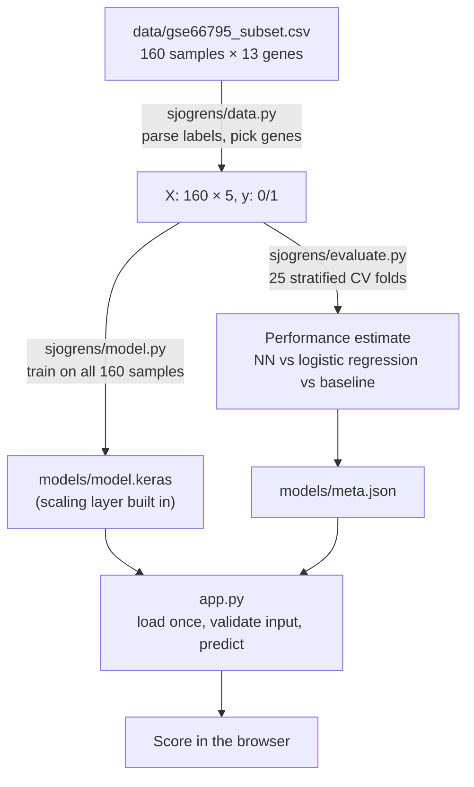

# predict-sjogrens

[](https://github.com/bhatiajay/predict-sjogrens/actions/workflows/tests.yml)

A neural network that scores whole-blood gene expression for a Sjögren's syndrome
signature, served through a small Flask web app.

You enter expression levels for five genes (IRF5, SSB, TRIM21, MX1, IFI44). The model
returns a 0–100% score for how closely the profile matches the Sjögren's patients it
was trained on. It started as a 2024–25 science fair project. The original code is
preserved at tag [`v1-science-fair`](https://github.com/bhatiajay/predict-sjogrens/tree/v1-science-fair).

> **Not a diagnostic tool.** It was trained on 160 samples from women, 82% of them
> patients, so the score ranks profiles but isn't a real-world probability of disease.

## Results

Repeated stratified cross-validation (5 folds × 5 repeats = 25 held-out test folds),
mean ± standard deviation. Reproduce with `uv run python train.py`.

**5 genes (default model)**

| Model | ROC AUC | Balanced accuracy | Sensitivity | Specificity |
|---|---|---|---|---|
| Neural network | 0.877 ± 0.062 | 0.845 ± 0.068 | 0.828 ± 0.065 | 0.863 ± 0.141 |
| Logistic regression | 0.900 ± 0.054 | 0.867 ± 0.069 | 0.845 ± 0.076 | 0.889 ± 0.123 |
| Always guess "patient" | 0.500 | 0.500 | 1.000 | 0.000 |

**All 13 genes** (`uv run python train.py --features all`)

| Model | ROC AUC | Balanced accuracy | Sensitivity | Specificity |
|---|---|---|---|---|
| Neural network | 0.897 ± 0.058 | 0.818 ± 0.098 | 0.869 ± 0.055 | 0.767 ± 0.212 |
| Logistic regression | 0.878 ± 0.065 | 0.849 ± 0.075 | 0.849 ± 0.076 | 0.848 ± 0.155 |

**What this shows**
- The expression data carries a real signal. Most of it comes from interferon-response
  genes (MX1 and IFI44 in the 5-gene set).
- On this small dataset the neural network performs about the same as plain logistic
  regression. The differences are well within the fold-to-fold spread.
- The "always guess patient" baseline gets 82% *accuracy* while never identifying a
  single control. That's why AUC, sensitivity and specificity are reported instead.

## Quick start

Needs [uv](https://docs.astral.sh/uv/). It installs the right Python (3.12) and the
exact package versions from `uv.lock`.

```bash
git clone https://github.com/bhatiajay/predict-sjogrens.git
cd predict-sjogrens
uv sync                                  # create .venv with locked dependencies
uv run python train.py                   # evaluate (~1 min), then save models/model.keras
uv run flask --app app run --port 5001   # open http://127.0.0.1:5001
```

On the home page, the **typical patient / typical control** links fill the form with each
group's median values.

Port 5001 is used because macOS reserves 5000 for AirPlay Receiver.

## How it works



1. **Data** (`sjogrens/data.py`): reads the CSV, maps `patient group: Patient` → 1 and
   `Control` → 0, and raises an error on anything unexpected.
2. **Model** (`sjogrens/model.py`): `Normalization` → Dense(64, ReLU) → Dropout(0.3) →
   Dense(32, ReLU) → Dense(1, sigmoid), with L2 weight penalties.
   - The normalization layer learns each gene's mean and spread from the training data
     only, and it's saved inside the model file. Training, evaluation and the app
     therefore always scale inputs the same way.
   - Class weights make errors on the rarer controls count more.
3. **Evaluation** (`sjogrens/evaluate.py`): repeated stratified k-fold. The neural
   network, logistic regression and a majority-class baseline are all scored on the same
   folds.
4. **Final model** (`train.py`): after evaluation, a fresh model is trained on all 160
   samples and saved, along with `meta.json`, which holds the gene list, input ranges,
   example values and CV results.
5. **Web app** (`app.py`, `templates/`):
   - loads the saved model at startup
   - checks every input, re-showing the form with a message for blank or non-numeric values
   - warns when a value is outside the range seen in training

`notebooks/walkthrough.ipynb` steps through all of this with plots and explanations.

## Project layout

```
├── app.py                  Flask web app
├── train.py                evaluate + train + save
├── sjogrens/
│   ├── config.py           paths, probe→gene map, feature sets, seed
│   ├── data.py             load and validate the dataset
│   ├── model.py            build / train / score the network
│   ├── evaluate.py         cross-validation and metrics
│   └── artifacts.py        save / load model + meta.json
├── templates/              HTML for the app
├── notebooks/walkthrough.ipynb
├── tests/                  pytest suite
└── data/                   dataset + its README
```

## Tests

```bash
uv run pytest
```

The tests check:
- label parsing (131 patients / 29 controls) and that bad data is rejected
- that a saved and reloaded model gives identical scores
- that the network learns well above chance, and scores a typical patient above a typical control
- the web app's responses to valid, blank, non-numeric and out-of-range input

GitHub Actions runs the tests, a short training run and the notebook on every push and
pull request.

## Changes from the science fair version

- **Fixed labels.** The original checked `'Sjogren' in x`, but the labels say
  `Patient` / `Control`, so every sample was labeled 0 and the saved model was untrained.
- **Dropped gender.** It's constant (all samples are female), and the web form encoded
  it the opposite way from training.
- **Moved scaling inside the model.** The scaler used to be fit on all data before the
  cross-validation split (leakage). It's now a layer fit on training data only.
- **Train once, serve many times.** The final model is trained on all data instead of
  keeping the luckiest fold's model, and the app loads it instead of retraining on every
  start.
- **Honest metrics.** Evaluation reports AUC, sensitivity and specificity, compared
  against logistic regression and a baseline.
- **Corrected data source.** The original report cited GSE51092; the data is actually
  GSE66795 (see [`data/README.md`](data/README.md)).
- **Tidier project.** One package instead of five script variants, with tests,
  locked dependencies and CI.

## Limitations

- **Small and skewed sample.** 29 controls means every metric has wide error bars.
- **Women only.** All samples are female, so behavior on male samples is unknown.
- **One cohort, one platform.** There's no external validation. Values from another
  microarray or RNA-seq aren't on the same scale and would need re-normalizing.
- **Not a probability of disease.** The training set is 82% patients, far above
  real-world prevalence, so the score is a pattern-match score, not a clinical risk.
